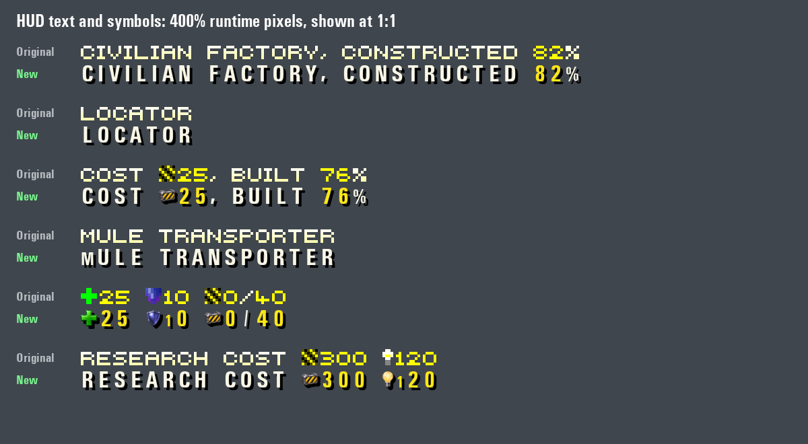
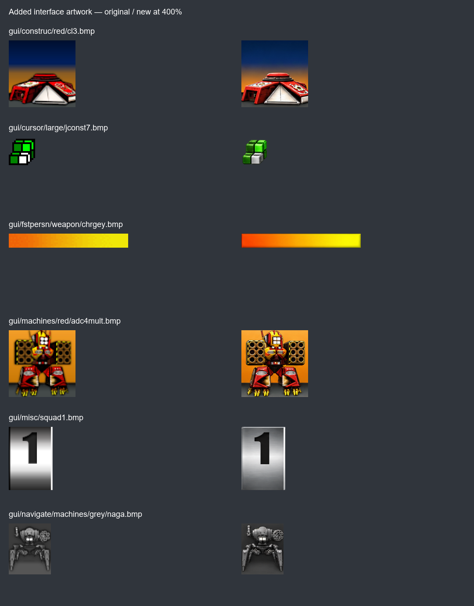
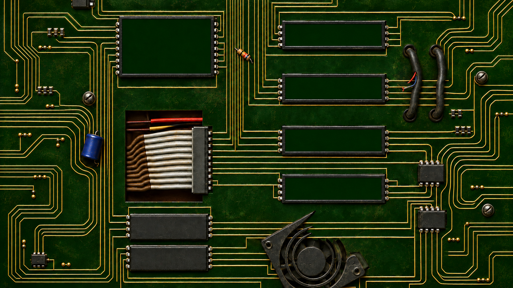

# Optional HD interface artwork

This contribution combines the display/UI scaling code and its high-resolution
artwork in one PR. The original game remains available without the HD packs.







## Included artwork

| Runtime directory | Coverage | Image files | Retained masters |
| --- | --- | ---: | ---: |
| `mods/faithful-hd-hud` | 241 shared sprites and five font families: command buttons and their states, HUD numbers, faction/navigation controls, first-person controls/radar/reticles, resource/health/armour/research glyphs and six status overlays | 984 | 31 |
| `mods/faithful-hd-menus` | 19 menu/dialog layouts, 17 continuous widescreen boards, 205 inherited animation-frame signals and 18 outline menu-font atlases | 932 | 20 |
| `mods/faithful-hd-intros` | Four static startup cards: publisher logo, developer logo, legal card and loading image, plus the bootstrap BMP | 25 | 4 |
| `mods/faithful-hd-interface-art` | 896 additional interface families: team-colour robot/building portraits, navigation categories, first-person weapon/radar panels, animated cursors, minimap markers, squad-number tiles and small menu controls | 3,584 | 32 |
| Total | Runtime variants across all four packs | **5,525** | **87** |

The image files occupy 466,896,031 bytes (about 445 MiB) before an archive or Git
compression. Most interface sprites have 1x–4x variants. Menu font and startup
card variants extend through 6x. Individual HUD sprites are sized for their
actual screen role; they are not wasteful 3840-pixel icons.

## Install or disable

Use a game installation with its original data and a binary built from this
contribution. Copy any desired `mods/faithful-hd-*` directories beside the
installation's existing `mods` directory contents. Copy the complete directory,
including its `gui` subdirectory, rather than merging textures into the original
`gui` files. Restart the game after changing packs.

To disable a pack, move its directory entirely outside `mods` and restart.
Renaming it while leaving it inside `mods` does not disable it: every mod
subdirectory is discovered. Other mods follow the existing alphabetical
priority rules documented in [mods/README.md](../mods/README.md).

For CMake installation/CPack, the large HD packs are excluded by default. Use
`-DINSTALL_HD_ARTWORK=ON` when configuring to include them in the installed game
package. This keeps the optional download size explicit. The HD files remain
part of this same source contribution regardless of that packaging choice.

The menu pack activates a fitted 4:3 control canvas inside continuous widescreen
artwork. At 3840x2160, controls use a 2880x2160 canvas (450%); the in-game HUD
retains its separately selected integer scale, up to 400%. Without the menu
pack, the original menu layout uses the normal integer-scale choices.

## What was rendered

The raster artwork was made with the built-in image-generation tool using
original game references. Active masters and their retained prompts are in the
four `art/hd-*` directories. This is AI-assisted reconstruction and interpretation
of small reference images, not a re-export of the original 3D models. Functional
glyph meanings were checked against the game code; see
[the symbol mapping](hd-hud/SYMBOL_SEMANTICS.md).

HUD white/yellow text and menu text are rasterized from outline fonts at their
target density while preserving the original byte indices and character
advances. The exporters use fonts from the user's original game data; no new
font binaries are bundled. Unsupported extended glyphs can retain bitmap
fallbacks. Original LOADING/SAVING typography is retained.

The six newly rendered status images are COMPLETE, VICTORY, FAILED, DEFEAT,
PAUSED and NETBUSY. They are bitmap overlays, distinct from the dynamic text
fonts used for quantities, names and percentages.

The wide-board menu animations reuse signed frame differences from 205 original
frames and retain the original `.anm` frame order, delays, loop points and sound
triggers. These are not 205 newly generated independent animations. Menu-to-menu
movie transitions use HD board slides driven by the original movie's clock,
audio and completion. Opening/game/post-loading cinematics are unchanged.

Actual generated master sizes are recorded in the manifests. Exported 4K
presentation dimensions do not imply native 4K generated detail in every source.
World/terrain textures, in-world 3D models and new movie renders are outside
this interface-art contribution. Original names, logos and legal text are
retained as game references; no ownership of the original game IP is claimed.

## Verify and reproduce

Run the portable manifest check without additional Python packages:

```sh
python scripts/check_hd_artwork.py
```

Open [the offline image gallery](preview.html) to browse the packaged artwork
by filename or pack. Each preview links to its full exported image.

For native image decoding and engine-style RGBA/colour-key conversion, build
`tools/hd-hud-check` with SDL3 and SDL3_image, then run `hud-asset-check` once per
pack with its maximum permitted image edge:

```sh
hud-asset-check mods/faithful-hd-hud 8192
hud-asset-check mods/faithful-hd-menus 8192
hud-asset-check mods/faithful-hd-intros 8192
hud-asset-check mods/faithful-hd-interface-art 8192
```

This decoder opens no video window. The intro list includes one BMP as well as
24 PNGs. The checker accepts both, despite its historical PNG output label.

For raster export, install `art/hd-hud/requirements.txt` in a Python environment
and set `MACHINES_ART_SOURCE` to an unmodified original game-data directory.
`scripts/hd_hud_assets.py pack`, `scripts/hd_menu_assets.py`, and
`scripts/hd_intro_assets.py` use the retained masters and original glyph/frame
metadata. `scripts/hd_interface_art.py export` needs only its retained masters
and crop manifest. Image generation itself is nondeterministic; the saved
masters, source hashes and crop layouts make the packaging step reviewable.

## Validation limits

Manifest hashes, dimensions, master hashes and native decoding have been
checked. Automated checks do not establish appearance, cursor hotspots, click
targets, animated-frame registration or correctness of every screen in gameplay.
The initial HUD subset was played during development; the complete pack,
especially the newest interface extension, still needs interactive review of
this combined build. Menu motion may need tuning where generated component
shapes differ from the original light signals. Linux and multiplayer validation
remain outstanding. This contribution is submitted as a draft for review.

On November 28, 2026, the combined source completed a clean native Windows x64
Release/MSVC build (1,321 steps), and all 32 CTest suites passed. SDL3_image
decoded and converted every one of the 5,525 exported images without opening
a video window. The public interface exporter reproduced all 3,584 interface
PNGs byte-for-byte from its retained masters. No game launch was performed in
this publication pass.
